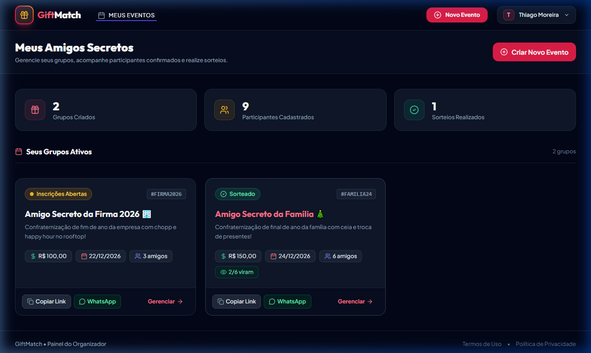
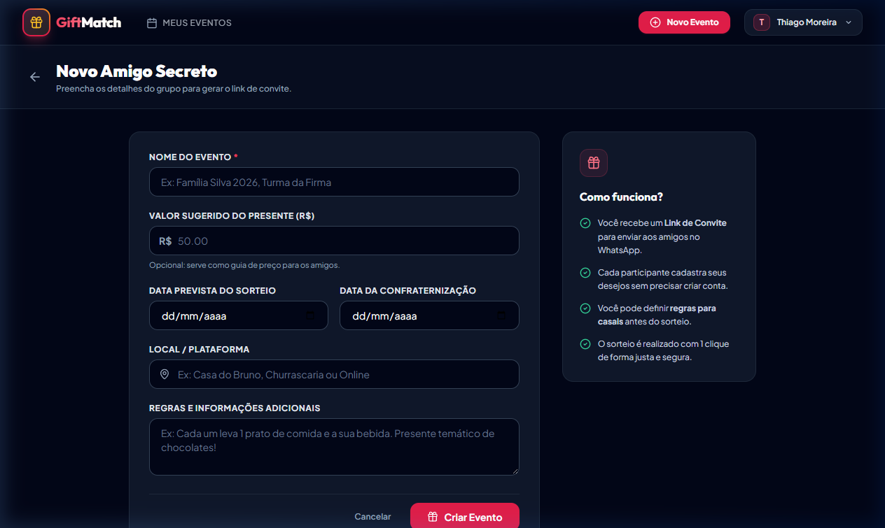
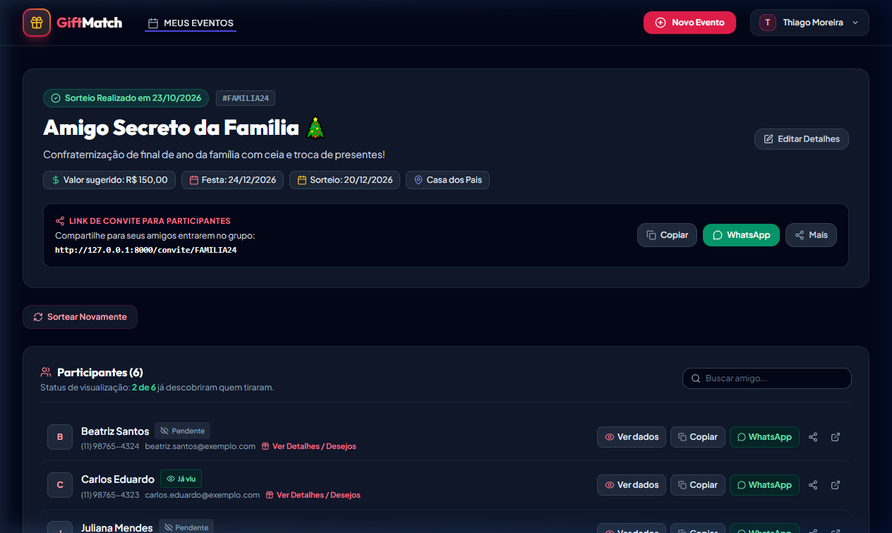
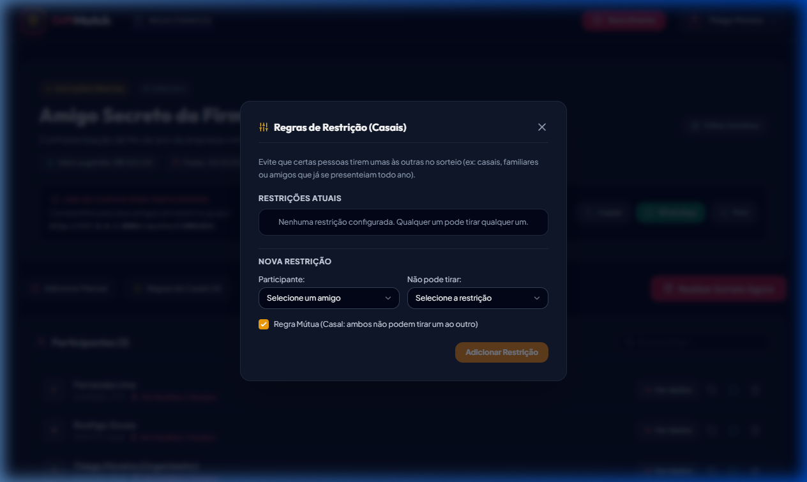
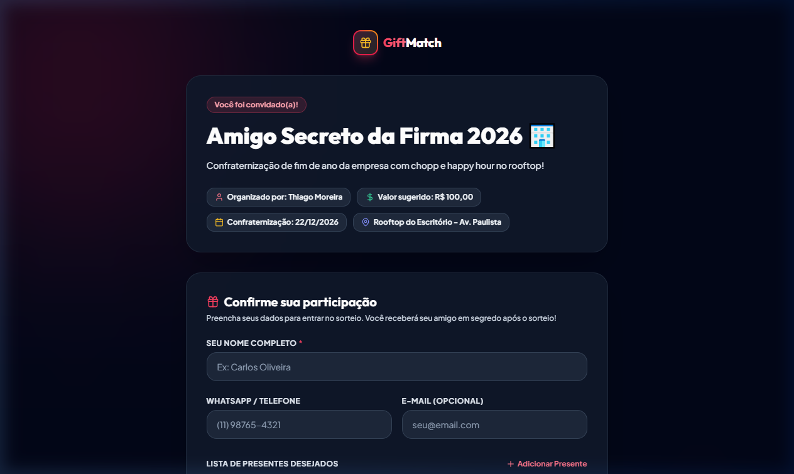
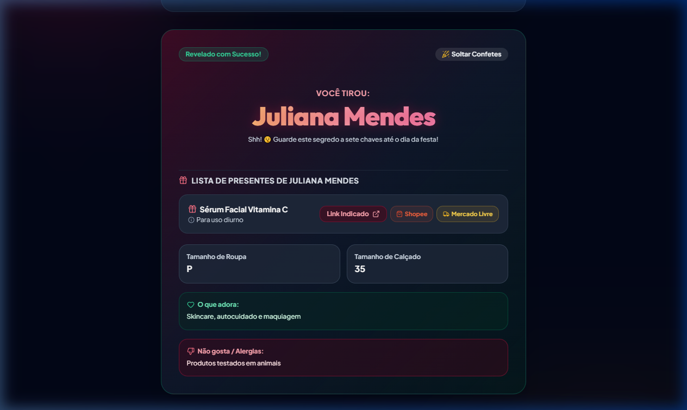
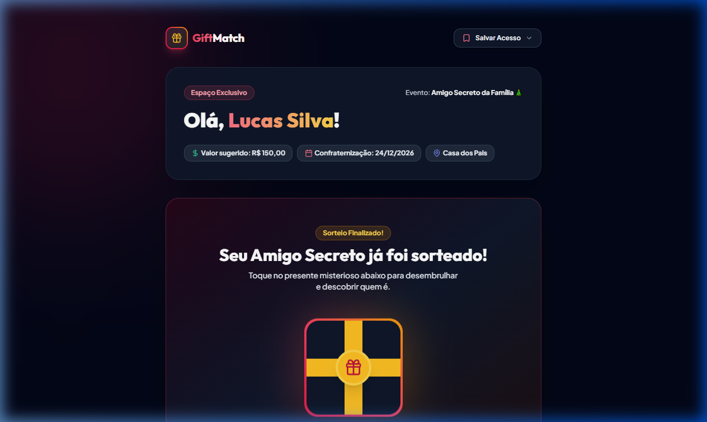

<p align="center">
  <a href="https://giftmatch.online" target="_blank">
    
  </a>
</p>

<h1 align="center">GiftMatch &bull; Amigo Secreto Online Inteligente</h1>

<p align="center">
  <strong>Plataforma Web Full-Stack moderna para criação e gestão de sorteios de Amigo Secreto / Amigo Oculto com regras de restrição para casais, listas de desejos e monetização por afiliados.</strong>
</p>

<p align="center">
  <a href="https://giftmatch.online" target="_blank">
    
  </a>
</p>

<p align="center">
  
  
  
  
  
  
  
  
</p>

---

## 📸 Demonstração Visual Completa do Sistema

### 1. Painel Principal do Organizador (Dashboard)
Visão consolidada de todos os eventos ativos, status do sorteio, contagem de participantes e atalhos rápidos de gestão.


---

### 2. Criação de Novo Amigo Secreto
Cadastro rápido com valor sugerido, data da confraternização, data do sorteio, local e orientações aos participantes.


---

### 3. Painel de Gestão do Evento e Participantes
Visualização da lista completa de participantes, link exclusivo de convite, status do sorteio, botão de envio direto no WhatsApp e links secretos de revelação.


---

### 4. Configuração de Regras de Restrição (Casais & Família)
Interface para configurar exclusões mútuas com apenas um clique (ex: impedir que parceiros, irmãos ou pessoas que já se tiraram no ano anterior tirem um ao outro).


---

### 5. Página Pública de Inscrição & Lista de Desejos (Convidados)
Sem exigir criação de senha, os convidados acessam pelo WhatsApp, confirmam presença, informam tamanhos de roupa, calçado, preferências e cadastram sua lista de presentes com links.


---

### 6. Tela Mágica de Revelação Secreta com Ideias de Presentes
Ao abrir o link secreto, o participante descobre seu amigo secreto, confere os tamanhos, o que a pessoa gosta/não gosta e tem acesso à lista de presentes com botões inteligentes da **Shopee** e **Mercado Livre**.


---

### 7. Tela de Suspense Pré-Revelação
Animação e contagem regressiva para criar o clima festivo antes de revelar quem foi sorteado.


---

### 8. Landing Page / Apresentação Institucional
Design responsivo em Dark Mode nativo com iluminação ambiente e alta performance para dispositivos móveis e desktop.


---

## ✨ Principais Diferenciais e Funcionalidades Técnicas

### 🎲 1. Algoritmo Inteligente de Sorteio com Restrições
* **Algoritmo de Derangement:** Garante matematicamente que ninguém tire a si mesmo ($f(x) \neq x$).
* **Matriz de Exclusões Bidirecionais:** Permite definir regras restritivas complexas (ex: casais, familiares diretos ou desafetos) sem gerar ciclos inválidos.
* **Prevenção de Impasses e Deadlocks:** Validação prévia da viabilidade do grafo de sorteio com algoritmo de backtracking e limite estocástico, informando ao organizador caso as restrições tornem o sorteio impossível.

### 📱 2. Experiência Zero-Friction via WhatsApp
* **Acesso Sem Senha para Convidados:** Participantes entram pelo link de convite e interagem sem atritos de cadastro demorado.
* **Ficha de Presentes Completa:** Tamanho de vestuário, calçado, gostos, aversões/alergias e lista com suporte a links externos.
* **Tokens Criptográficos Individuais:** Cada participante possui uma chave de acesso segura de 32 caracteres (alfanumérico aleatório) para conferir seu amigo secreto a qualquer momento.

### 🛍️ 3. Motor de Monetização Integrada (Shopee & Mercado Livre)
* **Busca Contextual Inteligente:** Botões automáticos em cada presente da lista apontando para a busca correspondente na Shopee e no Mercado Livre já com parâmetros de afiliado injetados (`matt_tool`, `matt_word`, `utm_source`, `mmp_pid`).
* **Conversor de Links no Backend:** O serviço [AffiliateLinkService.php](app/Services/AffiliateLinkService.php) intercepta links colados pelos convidados e adiciona os identificadores de afiliado de forma transparente.
* **Transparência & Compliance:** Mensagens explícitas de transparência nos termos da legislação brasileira (CDC, LGPD e diretrizes do CONAR).
* **Google AdSense:** Carregamento assíncrono não invasivo com componentes Vue preparados.

### ⚡ 4. Alta Performance & Otimização Core Web Vitals
* **Google Fonts Assíncrono:** Preload com `media="print" onload="this.media='all'"` e `display: swap`, eliminando bloqueios de renderização e derrubando FCP/LCP para menos de 1 segundo.
* **Vite / Rollup Manual Chunks:** Unificação de micro-arquivos da biblioteca de ícones em pacote único cacheável (`vendor-icons.js`), eliminando dezenas de requisições encadeadas da cascata de rede.
* **SEO e Compartilhamento Social:** Metatags Open Graph dinâmicas com geração de previews temáticos no WhatsApp, Facebook e Twitter.

---

## 🛠️ Stack Tecnológica

| Camada | Tecnologia | Descrição |
| :--- | :--- | :--- |
| **Backend** | [PHP 8.4](https://www.php.net/) + [Laravel 12](https://laravel.com/) | Arquitetura MVC, Form Requests, Services e Eloquent ORM |
| **Frontend** | [Vue 3](https://vuejs.org/) (`<script setup>`) | Composition API reativa e componentes modulares |
| **Ponte SPA** | [Inertia.js v2](https://inertiajs.com/) | Roteamento SPA fluido sem sobrecarga de APIs GraphQL/REST manuais |
| **Estilização** | [Tailwind CSS v3](https://tailwindcss.com/) | Design System festivo e moderno em Dark Theme nativo |
| **Banco de Dados**| [PostgreSQL (Neon)](https://neon.tech/) / [SQLite](https://sqlite.org/) | Migrações relacionais e suporte a múltiplos drivers |
| **E-mails** | [Resend](https://resend.com/) / SMTP | Notificações transacionais seguras |
| **Efeitos Visuais**| [Canvas-Confetti](https://www.npmjs.com/package/canvas-confetti) | Animações de celebração na revelação |
| **Testes** | [PHPUnit](https://phpunit.de/) | 35 testes automatizados cobrindo autenticação, restrições e sorteio |

---

## 🚀 Como Executar Localmente

### Pré-requisitos
* PHP >= 8.2 (Recomendado PHP 8.4)
* Composer
* Node.js >= 18 e NPM
* SQLite ou PostgreSQL

### Passo a Passo

1. **Clone o repositório:**
   ```bash
   git clone https://github.com/giftmatch/amigosecreto.git
   cd amigosecreto
   ```

2. **Instale as dependências do PHP:**
   ```bash
   composer install
   ```

3. **Instale as dependências do Frontend:**
   ```bash
   npm install
   ```

4. **Configure as variáveis de ambiente:**
   ```bash
   cp .env.example .env
   php artisan key:generate
   ```

5. **Execute as migrações e popule o banco de dados com dados de teste:**
   ```bash
   php artisan migrate --seed
   ```
   > O seeder cria automaticamente o usuário `admin@giftmatch.online` (senha: `password`) com 2 eventos configurados, participantes, restrições de casais e listas de presentes para demonstração imediata!

6. **Inicie o servidor de desenvolvimento:**
   * Em um terminal:
     ```bash
     npm run dev
     ```
   * Em outro terminal:
     ```bash
     php artisan serve
     ```

7. **Acesse no navegador:**
   [http://localhost:8000](http://localhost:8000)

---

## 🧪 Suíte de Testes Automatizados

O projeto conta com suíte de testes cobrindo autenticação, ciclo de vida dos eventos, restrições de casais, validação de tokens e algoritmo de sorteio:

```bash
php artisan test --compact
```

Exemplo de resultado:
```json
{"tool":"phpunit","result":"passed","tests":35,"passed":35,"assertions":120}
```

---

## 🔒 Segurança & Privacidade

* **Tokens Não Sequenciais:** Participantes recebem tokens alfanuméricos criptograficamente seguros.
* **Proteção contra SQL Injection & Mass Assignment:** Validações rigorosas via Form Requests e Eloquent ORM.
* **Sanitização de URLs:** Proteção contra ataques XSS em links de presentes externos.
* **LGPD e Termos de Uso:** Páginas jurídicas institucionais com consentimento de cookies e tratamento de dados em conformidade com as normas brasileiras.

---

## 👨‍💻 Mantenedor & Contato

Desenvolvido pela equipe **GiftMatch**.

* **Projeto Online:** [https://giftmatch.online](https://giftmatch.online)
* **Suporte:** [suporte@giftmatch.online](mailto:suporte@giftmatch.online)

---

## 📄 Licença

Este projeto está sob a licença [MIT](LICENSE).
