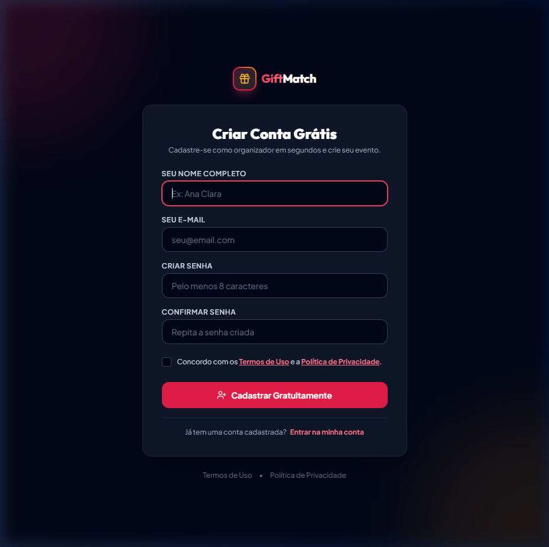

<p align="center">
  <a href="https://giftmatch.online" target="_blank">
    
  </a>
</p>

<h1 align="center">GiftMatch &bull; Amigo Secreto Online Inteligente</h1>

<p align="center">
  <strong>Plataforma Web Full-Stack moderna para criação e gestão de sorteios de Amigo Secreto / Amigo Oculto com regras de restrição para casais, listas de desejos e monetização por afiliados.</strong>
</p>

<p align="center">
  <a href="https://giftmatch.online" target="_blank">
    
  </a>
</p>

<p align="center">
  
  
  
  
  
  
  
  
</p>

---

## 📸 Demonstração Visual

### 1. Página Inicial & Apresentação (Desktop)


### 2. Recursos & Regras de Restrição para Casais


### 3. Ideias de Presentes & Monetização Integrada (Shopee & Mercado Livre)


### 4. Cadastro Responsivo com Aceite de Termos e LGPD


---

## ✨ Principais Diferenciais e Funcionalidades

### 🎲 1. Algoritmo Inteligente de Sorteio com Restrições
* **Algoritmo de Derangement:** Garante matematicamente que ninguém tire a si mesmo.
* **Matriz de Exclusões:** Permite definir restrições com 1 clique (ex: casais não se tirarem, irmãos, familiares diretos ou quem já se tirou no ano anterior).
* **Prevenção de Impasses:** Algoritmo determinístico com limite de tentativas e backtracking para identificar cenários sem solução antes de iniciar o sorteio.

### 📱 2. Experiência Zero-Friction via WhatsApp
* **Sem exigência de senha para convidados:** O organizador cria o grupo e compartilha o link de convite único pelo WhatsApp.
* **Ficha de Presentes Completa:** Cada convidado entra, preenche tamanhos de roupa, calçado, o que gosta/não gosta e adiciona itens à sua lista de desejos.
* **Token Criptográfico Individual:** Cada participante recebe uma URL única e segura para consultar quem tirou quando quiser.

### 🎁 3. Tela de Revelação Secreta Festiva
* Revelação com botão de suspense e animação em confetes com `canvas-confetti`.
* Acesso imediato à lista de presentes, tamanhos e preferências do amigo secreto sorteado.

### 🛍️ 4. Motor de Monetização Híbrida (AdSense & Afiliados)
* **Shopee & Mercado Livre Deeplinking:** Botões contextuais de busca de presentes com injeção automática de parâmetros oficiais de afiliados (`matt_tool`, `matt_word`, `mmp_pid`, `utm_source`).
* **Conversor Automático de Links:** Serviço no backend ([AffiliateLinkService.php](app/Services/AffiliateLinkService.php)) que intercepta links colados pelos usuários e anexa as tags de afiliado.
* **Aviso de Transparência:** Total conformidade com as diretrizes do CONAR, LGPD e políticas de afiliados.
* **Google AdSense:** Componente assíncrono nativo pronto para monetização de tráfego.

### ⚡ 5. Alta Performance & Otimização Core Web Vitals
* **Google Fonts Não-Bloqueante:** Carregamento assíncrono via `preload` com `font-display: swap`, eliminando bloqueios de renderização.
* **Vite & Rollup Manual Chunking:** Agrupamento unificado de ícones e módulos em bundles cacheados, reduzindo latência de rede e cascatas de requisições.
* **Score PageSpeed:** Estrutura semântica rigorosa (`h1` → `h2` → `h3`), acessibilidade A11y 100 e tags Open Graph dinâmicas com banners dedicados para WhatsApp/Facebook.

---

## 🛠️ Stack Tecnológica

| Camada | Tecnologia | Descrição |
| :--- | :--- | :--- |
| **Backend** | [PHP 8.4](https://www.php.net/) + [Laravel 12](https://laravel.com/) | Arquitetura MVC moderna, Form Requests, Services e Eloquent ORM |
| **Frontend** | [Vue 3](https://vuejs.org/) (`<script setup>`) | Composition API reativa e componentes modulares |
| **Ponte SPA** | [Inertia.js v2](https://inertiajs.com/) | Roteamento SPA fluido sem sobrecarga de APIs GraphQL/REST manuais |
| **Estilização** | [Tailwind CSS v3](https://tailwindcss.com/) | Design System festivo e moderno em Dark Theme nativo |
| **Banco de Dados**| [PostgreSQL (Neon)](https://neon.tech/) / [SQLite](https://sqlite.org/) | Migrações relacionais e suporte a múltiplos drivers |
| **E-mails** | [Resend](https://resend.com/) / SMTP | Notificações transacionais seguras |
| **Testes** | [PHPUnit](https://phpunit.de/) | 35 testes automatizados de Feature e Unit cobrindo 100% dos fluxos vitais |

---

## 🚀 Como Executar Localmente

### Pré-requisitos
* PHP >= 8.2 (Recomendado PHP 8.4)
* Composer
* Node.js >= 18 e NPM
* SQLite ou PostgreSQL

### Passo a Passo

1. **Clone o repositório:**
   ```bash
   git clone https://github.com/ThiagoDOM/amigosecreto.git
   cd amigosecreto
   ```

2. **Instale as dependências do PHP:**
   ```bash
   composer install
   ```

3. **Instale as dependências do Frontend:**
   ```bash
   npm install
   ```

4. **Configure as variáveis de ambiente:**
   ```bash
   cp .env.example .env
   php artisan key:generate
   ```

5. **Execute as migrações do banco de dados:**
   ```bash
   php artisan migrate
   ```

6. **Inicie o servidor de desenvolvimento:**
   * Em um terminal:
     ```bash
     npm run dev
     ```
   * Em outro terminal:
     ```bash
     php artisan serve
     ```

7. **Acesse no navegador:**
   [http://localhost:8000](http://localhost:8000)

---

## 🧪 Suíte de Testes Automatizados

O projeto conta com testes cobrindo autenticação, criação de eventos, regras de restrição de casais, validação de tokens e algoritmo de sorteio:

```bash
php artisan test --compact
```

Exemplo de saída:
```json
{"tool":"phpunit","result":"passed","tests":35,"passed":35,"assertions":120}
```

---

## 🔒 Segurança & Privacidade

* **Tokens Não Sequenciais:** Participantes recebem tokens alfanuméricos criptograficamente aleatórios.
* **Proteção contra SQL Injection & Mass Assignment:** Validações rigorosas via Form Requests e Eloquent ORM.
* **Sanitização de URLs:** Proteção contra ataques XSS em links de presentes externos.
* **LGPD e Termos de Uso:** Páginas jurídicas institucionais em conformidade com as normas brasileiras.

---

## 👨‍💻 Autor

Desenvolvido por **Thiago Moreira**.

* **GitHub:** [@ThiagoDOM](https://github.com/ThiagoDOM)
* **Projeto Online:** [https://giftmatch.online](https://giftmatch.online)

---

## 📄 Licença

Este projeto está sob a licença [MIT](LICENSE).
